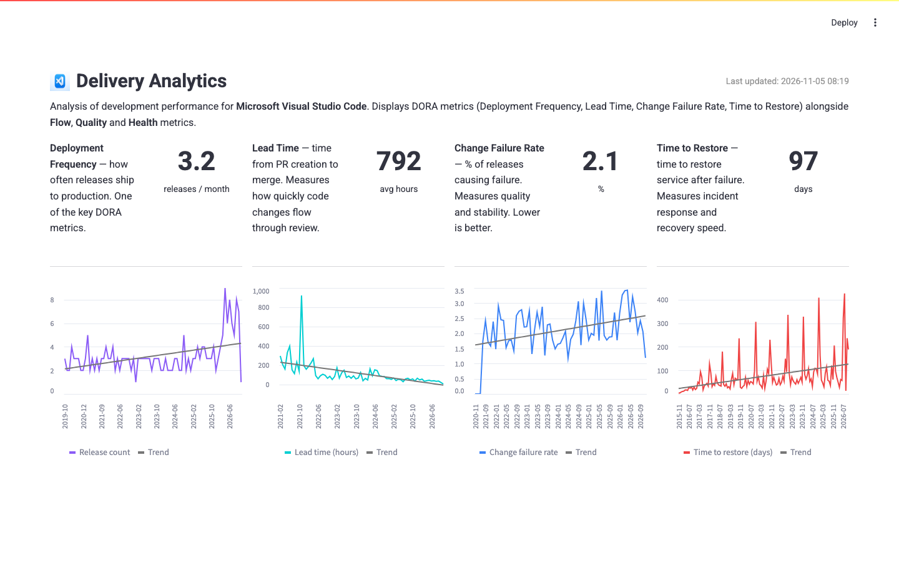

# DORA Metrics Platform

<p align="center">
  
</p>

**A platform for analyzing development metrics (DORA/Flow)** — a complete tool to monitor the performance of the **Microsoft Visual Studio Code** development team. It uses Google DORA (DevOps Research and Assessment) and Microsoft Flow Analytics standards to evaluate the VS Code development process.

The platform collects data from GitHub (pull requests, releases, commits, issues, milestones, workflow runs), transforms it using a medallion architecture, and shows it in an interactive Streamlit dashboard.

---

## 📊 Metrics

### 🏆 Core DORA Metrics (4 metrics)

**Deployment Frequency** — releases per month.
- **What it measures:** how many times the team ships code to production per month.
- **Why it matters:** it defines the team maturity level (Elite / High / Medium / Low).

**Lead Time for Changes** — time from commit to PR merge (hours).
- **What it measures:** how long code takes to go from writing to production.
- **Why it matters:** it shows the speed of code review and delivery.

**Change Failure Rate** — percentage of failed releases.
- **What it measures:** the share of commits that contain a revert.
- **Why it matters:** it shows code quality and change stability.

**Time to Restore Service** — recovery time after a failure (days).
- **What it measures:** time from bug report to close.
- **Why it matters:** it shows how fast the team reacts to incidents.

### 📈 Supporting Metrics (16 metrics)

**Flow & Efficiency (7 metrics):**
| Metric | What it measures | Why it matters |
|--------|-----------------|----------------|
| PR Merge Rate | % of merged PRs | delivery speed |
| PR Closed Time | average PR life time | team workload |
| Assignee Coverage | % of PRs/issues with an assignee | avoid lost tasks |
| Stale PR Rate | % of PRs inactive for 7+ days | review quality |
| Draft PR Ratio | % of draft PRs | metric noise |
| Locked PR/Issue Ratio | % of locked discussions | community engagement |
| Issue-to-PR Ratio | ratio of issues to PRs | work completeness |

**Code Quality (4 metrics):**
| Metric | What it measures | Why it matters |
|--------|-----------------|----------------|
| Revert Rate | % of commits with revert | code quality |
| GPG Signature Rate | % of verified commits | security |
| Author/Committer Mismatch | % of commits with different author and committer | review transparency |
| Quick Win Ratio | % of issues closed in 1 day | speed of fixing small problems |

**Project Health (5 metrics):**
| Metric | What it measures | Why it matters |
|--------|-----------------|----------------|
| Commit Velocity | average commits per month | development pace |
| Top Author Share | share of code from top author | bus-factor risk |
| On-Time Milestones | % of milestones completed on time | plan adherence |
| Milestone Coverage | % of PRs linked to a milestone | release organization |
| Releases-to-PR Size Ratio | PR size per release | review complexity |

---

## 🏗 Architecture

### Overview

```
┌─────────────────┐    ┌──────────────────┐    ┌─────────────────┐
│   GitHub API    │───▶│   Airflow DAGs   │───▶│   DuckDB Store  │
│  (PRs, Issues,  │    │  (ETL Pipelines) │    │   (dbt Models)  │
│   Commits, etc.) │    └──────────────────┘    └────────┬────────┘
└─────────────────┘                                       │
                                                          ▼
                                                 ┌─────────────────┐
                                                 │ Streamlit App   │
                                                 │ (Dashboard)     │
                                                 └─────────────────┘
```

### Tech Stack

| Component | Technology | Purpose |
|-----------|------------|---------|
| Orchestration | Airflow | Schedule and monitor pipelines |
| Transformation | dbt | SQL models for ETL/ELT |
| Storage | DuckDB | Column OLAP database in one file |
| Visualization | Streamlit + Plotly | Interactive web dashboard |
| Containerization | Docker Compose | Single deployment environment |
| CI/CD | GitHub Actions | Build automation |

---

## 🗄 Data Architecture: Medallion Model

The project uses the classic medallion architecture (Bronze → Silver → Gold) built with dbt.

### Bronze (Raw Layer) — raw data

A direct copy of the GitHub API. Data is loaded as-is in JSON format without transformations.

**7 models:**
| Model | Source | Approx. rows |
|-------|--------|--------------|
| `raw_commits` | `/repos/{owner}/{repo}/commits` | 10,000+ |
| `raw_issues` | `/repos/{owner}/{repo}/issues` | 5,000+ |
| `raw_pull_requests` | `/repos/{owner}/{repo}/pulls` | 3,000+ |
| `raw_releases` | `/repos/{owner}/{repo}/releases` | 200+ |
| `raw_milestones` | `/repos/{owner}/{repo}/milestones` | 50+ |
| `raw_workflow_runs` | `/repos/{owner}/{repo}/actions/runs` | 8,000+ |

**Features:**
- JSON fields are parsed with `PARSE_JSON()` in DuckDB
- Supports incremental loading by timestamp
- Each row has a unique ID from the GitHub API

### Silver (Staged Layer) — cleaned and structured data

Bronze data is cleaned, standardized, and enriched. Key transformations:

**6 models:**
| Model | Main transformations |
|-------|---------------------|
| `stg_commits` | Flatten JSON, extract author/committer, type dates |
| `stg_issues` | Flatten, parse labels, state tracking, normalize |
| `stg_pull_requests` | Flatten changes, diff stats, review metadata |
| `stg_releases` | Flatten, extract assets, author info |
| `stg_milestones` | Flatten, state tracking, issue count aggregation |
| `stg_workflow_runs` | Flatten, CI/CD status mapping, timing calculations |

**Features:**
- `unique_key` + `primary_key` for deduplication
- Incremental strategy to save resources
- Strict typing for all columns

### Gold (Marts Layer) — business metrics

Final marts tables ready for analytics. All DORA and Flow metrics are calculated here.

**9 models:**

| Model | Type | Description |
|-------|------|-------------|
| `core_deployment_frequency` | Core DORA | Releases per repo per month |
| `core_lead_time` | Core DORA | Lead Time (commit → merge), P50, P90 |
| `core_cfr` | Core DORA | Change Failure Rate (revert rate) |
| `core_time_to_restore` | Core DORA | Time to Restore (bug resolution time) |
| `core_dora_metrics_avg` | Aggregated | Average values of all DORA metrics |
| `supporting_flow` | Supporting | 7 Flow & Efficiency metrics |
| `supporting_quality` | Supporting | 4 Code Quality metrics |
| `supporting_health` | Supporting | 5 Project Health metrics |

**Features:**
- Grouped by `repo_name` and `period` (month)
- Aggregations: AVG, SUM, ROUND(2)
- `core_dora_metrics_avg` — materialized as a table (full slice by repos)

---

## 🧪 dbt Tests and Docs

### Data Tests
The dbt project includes 15+ YAML model files with built-in data tests for all 19 models:

| Test Type | Purpose |
|-----------|---------|
| `unique` | Primary key uniqueness |
| `not_null` | No NULL values in required fields |
| `accepted_values` | Validate allowed values (e.g., repo_name: ['vscode', 'airflow']) |

### Documentation
Full documentation is generated with:
```bash
dbt docs generate && dbt docs serve
```
It includes a lineage graph, descriptions of every model, columns, and dependencies between layers.

---

## 📁 Project Structure

```
dora-metrics-platform/
├── airflow/                      # ETL orchestration
│   ├── dags/                     # DAG files (data loading)
│   ├── logs/                     # Execution logs
│   └── plugins/                  # Custom Airflow plugins
├── dbt/                          # Data transformation
│   ├── models/
│   │   ├── 1_raw/                # Bronze layer (7 models + 7 yml)
│   │   ├── 2_staged/             # Silver layer (6 models + 6 yml)
│   │   ├── 3_marts/              # Gold layer (9 models)
│   │   ├── tests/                # dbt data_tests (YAML)
│   │   └── macros/               # dbt macros
│   └── README.md                 # dbt documentation
├── streamlit/                    # Visualization
│   └── app.py                    # Streamlit app (19 metrics)
├── config/                       # GitHub loading configs
├── data/                         # DuckDB database
├── tests/                        # Python tests (pytest)
├── docker-compose.yml            # Docker services
├── Dockerfile                    # Airflow image
├── Dockerfile.streamlit          # Streamlit image
└── requirements-streamlit.txt    # Python dependencies
```

---


